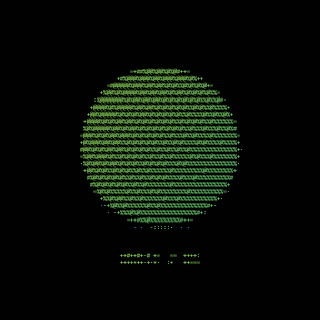
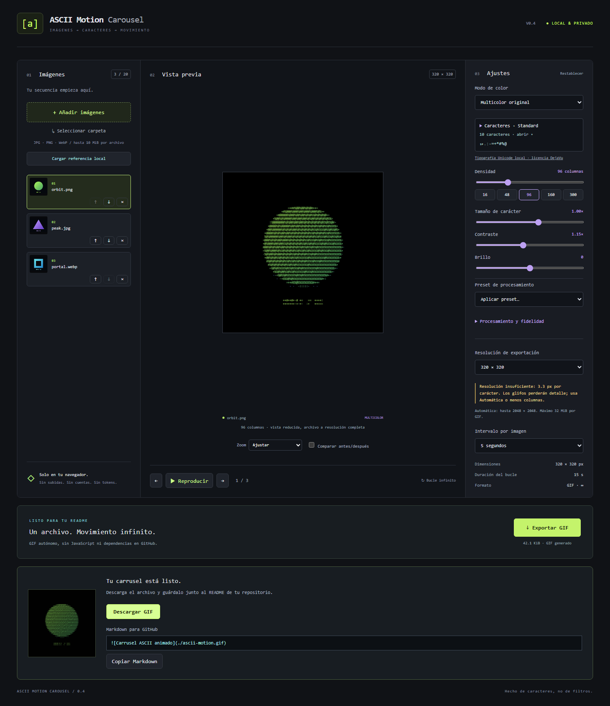
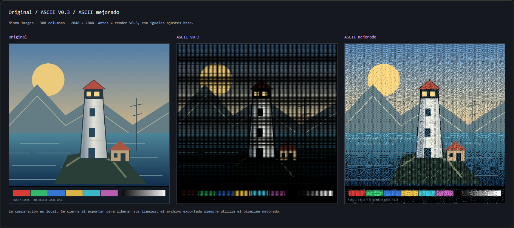
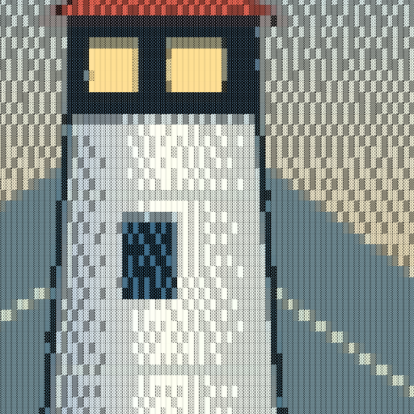

# ASCII Motion Carousel

**Convierte imágenes en un carrusel de arte ASCII a color y expórtalo como un GIF autónomo para GitHub.**

Procesamiento 100 % local, sin cuentas, sin servidores y sin telemetría. Proyecto independiente inspirado en la idea y la estética técnica de [GitAscii](https://github.com/Igorcbraz/GitAscii); no modifica ni depende de su código.



<sub>GIF real generado por la aplicación con tres figuras sintéticas locales. 320 × 320 px, tres fotogramas de cinco segundos y bucle infinito.</sub>

**Versión:** 1.0.0 · **Node:** 22.12–22.x · **Navegador validado:** Chromium actual · **Privacidad:** todo se procesa en el dispositivo.

## Características

| Área | Detalle |
| --- | --- |
| Carrusel | Hasta 20 imágenes JPG, PNG o WebP; reordenar, eliminar, reproducir y ajustar el intervalo entre 3, 5, 10 y 15 segundos |
| Densidad | De 16 a 300 columnas con actualización inmediata del número y debounce de 160 ms en el render |
| Resolución | 320 × 320, 640 × 640, 1024 × 1024 o automática hasta 2048 × 2048 |
| Estilos | 12 paletas, incluida una rampa Braille de luminosidad, True Braille 2×4 real y secuencias Custom Unicode |
| Color | Arte ASCII multicolor; el color se muestrea de la imagen y se separa de la cobertura del glifo |
| Procesamiento | Inversión, autocontraste por percentiles, gamma, realce de bordes Sobel y dithering Floyd–Steinberg |
| Exportación | GIF89a con paletas locales, progreso por imagen, cancelación y fragmento Markdown listo para copiar |
| Inspección | Comparación original / V0.3 reconstruido / resultado actual y zoom Ajustar, 100 % o 200 % |
| Privacidad | Sin backend, sin cargas de imágenes, sin tokens, sin CDN y sin analítica |

### Capturas

**Editor y vista previa**



**Comparación antes/después sobre la misma imagen**



**Detalle de glifos al 100 %**



## Inicio rápido

Requisitos:

- **Node.js 22.12 o posterior dentro de la rama 22** y npm.
- Un navegador Chromium actual para la aplicación. Para ejecutar los E2E se instala Chromium mediante Playwright.

```sh
git clone https://github.com/<tu-usuario>/ascii-motion-carousel.git
cd ascii-motion-carousel

# Si utilizas nvm:
nvm install 22
nvm use 22

npm ci
npm run dev
```

Abre **http://127.0.0.1:5173**. El servidor escucha solo en localhost.

Para probar la compilación de producción:

```sh
npm run build
npm run preview
```

La vista previa de producción utiliza **http://127.0.0.1:4173**. No abras `dist/index.html` mediante `file://`: el editor necesita módulos y un worker servidos por HTTP local.

## Crear tu primer carrusel

1. Pulsa **Añadir imágenes** y selecciona hasta 20 JPG, PNG o WebP; también puedes importar una carpeta completa.
2. Reordena con las flechas, selecciona una miniatura para inspeccionarla o elimina con ×.
3. Mantén **Multicolor original** y ajusta la densidad: **16–300 columnas**, paso de una, inicialmente **96**. Los botones 16 / 48 / 96 / 160 / 300 son atajos y no cambian el resto de ajustes.
4. Elige el intervalo, por ejemplo **5 segundos**. **Reproducir** recorre las imágenes en bucle; las flechas permiten avanzar manualmente.
5. Selecciona **320 × 320**, **640 × 640**, **1024 × 1024** o **Automática** y pulsa **Exportar GIF**. El codificador trabaja en un worker local con progreso por imagen y botón **Cancelar exportación**.
6. Descarga `ascii-motion.gif` y copia el Markdown generado. Cambiar imágenes, ajustes o intervalo invalida la descarga anterior: exporta de nuevo.

### Comparar, procesar e inspeccionar

La conversión mide la cobertura de caracteres reales, hace que Shading llene sus celdas y separa cromaticidad e intensidad. **No se dibuja una fotografía debajo del ASCII.**

1. Pulsa **Cargar referencia local**, elige **Blocks / Shading**, **300 columnas** y **Automática** para reproducir la prueba del proyecto.
2. Activa **Comparar antes/después** para ver el original, el render V0.3 reconstruido y el resultado actual con la misma imagen y densidad.
3. En **Procesamiento y fidelidad** encontrarás inversión de densidad, niveles por percentiles, gamma, Sobel regulable y dithering. Son independientes y reversibles; el dithering está activo inicialmente.
4. Prueba **Classic ASCII**, **High Detail**, **Edge Enhanced**, **Color Fidelity** o **Retro Terminal**. Son combinaciones de los mismos controles y no cambian columnas ni resolución.
5. Usa **Zoom 100 %** para inspeccionar píxeles sin reducción. Ajustar / 100 % / 200 % no modifican el ASCII ni el GIF. Exportar cierra la comparación para ahorrar memoria.

[Diagnóstico frente a GitAscii](./docs/v04/DIAGNOSIS.md) · [Algoritmos, medidas y límites](./docs/v04/README.md) · [Comparación visual](./docs/v04/comparison.png)

En la referencia fija del proyecto, el error RGB de seis muestras baja de **96,77 a 3,65**, y la luma media pasa de **29,87 a 110,67** frente a **113,69** del original. Es una mejora comprobada sobre V0.3, no una afirmación de superioridad universal frente a GitAscii. Su código GPL se inspeccionó únicamente para diagnóstico; no se copió.

## Estilos y True Braille

Abre **Caracteres** para ver nombre, muestra, cantidad y descripción de los **12 estilos**: Detailed / Classic ASCII, Standard, Simple, Blocks / Shading, Braille / Dots, Matrix / Hex, Binary, Slash Pattern, Retro Orbs, Minimal, True Braille 2×4 y Custom.

- **Braille / Dots** es una rampa de luminosidad; **True Braille 2×4** es otro algoritmo: toma ocho muestras por celda y construye los bits Unicode. Tiene umbral de 0 a 255 y dithering Floyd–Steinberg opcional. El color se aproxima con el promedio RGB de los puntos activos.
- **Custom** acepta entre 2 y 128 grafemas distintos de oscuro a claro, incluidos Unicode compuesto y emojis. Su muestra textual se actualiza inmediatamente y el Canvas conserva el debounce de 160 ms. Puedes invertir la secuencia. Las secuencias inválidas bloquean la exportación y conservan la última vista previa válida.
- Se guardan localmente el estilo, la última secuencia válida, el umbral y el dithering específico de Braille. No se guardan imágenes, resolución, zoom ni filtros generales. Si Storage está bloqueado, el editor funciona durante la sesión.
- La rampa Classic anterior estaba etiquetada como 70, pero tenía 67 símbolos. Se añadieron los tres ausentes (`'`, `<`, `>`) para ofrecer realmente 70. Se conservan sus identificadores y las paletas Standard/Simple originales.

Más detalles en [la guía de estilos y True Braille](./docs/v03/README.md).

## Resolución y densidad

**Automática** busca al menos seis píxeles horizontales por columna en el área real de la imagen y utiliza la mayor resolución necesaria del lote para que todos los fotogramas midan lo mismo.

| Columnas | Resolución automática |
| --- | --- |
| 16 / 48 | 320 × 320 |
| 96 | 640 × 640 |
| 160 | 1024 × 1024 |
| 300 | 2048 × 2048 |

Los retratos pueden requerir una resolución mayor. El límite automático es **2048 × 2048**: si aun así faltan píxeles, o eliges una resolución explícita insuficiente, verás una advertencia. No se reduce silenciosamente el número de columnas. A 300 columnas, 320 px no permiten mostrar caracteres legibles: esa opción se conserva por compatibilidad, no como recomendación de calidad. La vista previa conserva la resolución interna del GIF y solo se reduce visualmente mediante CSS.

## Exportación e integración en GitHub

Guarda el GIF junto al README de tu repositorio y utiliza:

```md

```

Si lo guardas en otra carpeta, adapta la ruta, por ejemplo `./assets/ascii-motion.gif`. Solo el archivo GIF debe estar disponible en el repositorio: no hacen falta React, Canvas, tokens, servicios ni JavaScript. La subida del GIF a GitHub es una acción manual; el editor nunca publica archivos. La demostración de este proyecto utiliza `./docs/demo/ascii-motion.gif`.

## Cómo funciona

- El importador valida MIME, tamaño y dimensiones decodificadas; un archivo con extensión válida pero contenido corrupto se rechaza. Los archivos válidos del mismo lote se conservan.
- Cada fuente se contiene proporcionalmente en el lienzo cuadrado elegido, con márgenes negros y transparencia compuesta sobre negro. Se guarda una referencia al `File` local y una miniatura de 80 px, sin persistir imágenes en disco ni localStorage. Se decodifica una fuente cada vez, hasta 2048 px en su lado mayor.
- Cada columna representa muestras independientes del área real de la imagen, no del padding. En rampas convencionales se muestrea al doble de columnas/filas y se promedian regiones 2×2 ponderadas por alpha; True Braille utiliza sus ocho muestras 2×4. La luminosidad perceptual pondera RGB (0.2126 / 0.7152 / 0.0722) y se respetan brillo/contraste y color.
- Canvas dibuja **solo glifos sobre fondo negro**, nunca la foto debajo de una rejilla. `measureText` mide avance, línea y límites; un atlas a 100 px mide la cobertura real y se rasteriza al tamaño nativo de cada celda. La selección de caracteres no depende de la resolución final. El modo monocromo usa tinta lima; las paletas dispersas tienen un límite físico de brillo.
- Preview y GIF usan el **mismo `renderSource` / `renderAscii`**, con igual resolución. El slider actualiza el número inmediatamente y aplica debounce de 160 ms al trabajo costoso; el dibujo cede el hilo en bloques de aproximadamente 8 ms. Caché LRU de renders con presupuesto de 16 MiB, no de toda la secuencia.
- La vista y la comparación se marcan como listas solo cuando terminan los píxeles de la configuración exacta solicitada. Así se evita mostrar un render anterior durante el debounce.
- Se genera un fotograma por imagen, con duración de 3, 5, 10 o 15 segundos y bucle infinito. Los renders idénticos **consecutivos** se fusionan sumando sus duraciones, sin repetir fotogramas para simular el tiempo de espera.
- [`modern-gif`](https://github.com/qq15725/modern-gif) 2.1 cuantiza y comprime cada imagen con hasta 255 colores. El adaptador ensambla un GIF89a con paletas locales para no retener todos los RGBA hasta finalizar. El worker conserva como máximo el frame pendiente y el entrante; cancelar lo termina y aborta el render. No hay llamadas a CDN ni descargas de fuentes.

## Límites y compatibilidad

| Aspecto | V1.0.0 |
| --- | --- |
| Entrada | JPG/JPEG, PNG y WebP con MIME reconocido por el navegador |
| Límites | 20 imágenes; 10 MiB por archivo; 16 millones de píxeles por imagen |
| Entrada animada | No se conserva la animación de APNG/WebP: se importa una imagen fija según el decodificador del navegador |
| No admitidos | GIF de entrada, SVG, HEIC, AVIF, vídeos y otros formatos |
| Carpeta | `webkitdirectory` cuando el navegador lo soporte; incluye subcarpetas; selector múltiple como alternativa |
| Orden inicial | Orden recibido del selector del navegador; no hay ordenación natural garantizada; reordena antes de exportar |
| Navegadores | Chromium actual probado; se requieren Canvas, createImageBitmap, Web Workers, FontFaceSet e Intl.Segmenter. Firefox/Safari actuales no están verificados en esta entrega |
| Portapapeles | Requiere contexto seguro (localhost o HTTPS); si falla, selecciona y copia el campo Markdown manualmente |
| Salida | GIF 320 / 640 / 1024 px o automático hasta 2048 px; máximo 32 MiB; fondo negro opaco, sin sonido ni fundidos |
| Color y fuente | El GIF reduce matices. Los tres estilos clásicos usan monospace del sistema; los nuevos incluyen DejaVu local para símbolos/Braille. Algunos grafemas Custom dependen de fuentes de respaldo del sistema |
| Recursos | Importación/exportación secuenciales; 120 s por respuesta del worker; render-cache 16 MiB y atlas-cache 16 MiB de backing stores; comparación opcional hasta 48 MiB adicionales a 2048 px; no son RAM total |
| Proporciones extremas | Máximo 2048 filas para acotar muestras; el rectángulo conserva proporción pero se limita el detalle vertical; avisos si el ancho por carácter es insuficiente |
| Persistencia | No se guardan proyectos ni imágenes. Solo las preferencias de caracteres/Braille sobreviven a recargar cuando localStorage está disponible |
| GitHub | El GIF es autónomo; visores, preferencias de movimiento reducido o clientes de Markdown pueden pausar animaciones |

La aplicación procesa las imágenes íntegramente en tu dispositivo. **La instalación de npm y de los navegadores de prueba sí requiere Internet**, pero la conversión y exportación no. Se sirve desde localhost y no incluye analítica, cuentas ni tokens.

## Privacidad

- Las imágenes se leen mediante `File`/`Blob` y se procesan en memoria con Canvas y Web Workers.
- No se envían imágenes, ajustes ni resultados a ningún servidor.
- No hay claves, variables de entorno, cookies de sesión ni servicios de terceros en tiempo de ejecución.
- Las preferencias de caracteres se guardan opcionalmente en `localStorage`; no se persisten imágenes.
- La única red necesaria es la instalación de dependencias y, para desarrollo, la descarga de Chromium para las pruebas.

## Desarrollo

```sh
npm run dev        # Servidor de desarrollo en 127.0.0.1:5173
npm run build      # TypeScript estricto + build de producción
npm run preview    # Sirve dist en 127.0.0.1:4173
npm test           # Vitest
npm run test:watch # Vitest en modo interactivo
npm run test:e2e   # Playwright + Chromium
npm run demo       # Regenera docs/demo/ascii-motion.gif y docs/demo/editor.png
```

Solo la primera vez:

```sh
npx playwright install chromium
```

Para ejecutar los E2E contra `dist/`, después de compilar:

```powershell
$env:E2E_PREVIEW='1'
npm run test:e2e
Remove-Item Env:E2E_PREVIEW
```

En shells POSIX, usa `E2E_PREVIEW=1 npm run test:e2e`.

### Pruebas

- **Vitest**: pruebas del motor puro, histograma/percentiles, gamma, Sobel con rechazo de ruido, color/cobertura, difusión, presupuestos de atlas y presets.
- **Playwright / Chromium**: pruebas del carrusel, importación, reordenación, intervalos, resolución, doce estilos, True Braille, referencia fija antes/después, métricas de color/contornos, filtros con reversión exacta, zoom sin modificar píxeles, hash ASCII entre resoluciones y GIF decodificado. La captura histórica V0.3 está omitida deliberadamente en la suite normal.
- La demostración se genera con tres figuras sintéticas locales, sin imágenes externas. El GIF tiene tres fotogramas de cinco segundos y una duración total de quince segundos. `npm run demo` solo escribe artefactos en `docs/demo/`; las pruebas normales escriben en `test-results/`.

## Estructura

```text
src/core/ascii.ts          Motor puro: luminosidad, caracteres y geometría
src/core/canvas.ts         Adaptador de muestreo y renderizado Canvas
src/core/processing.ts     Histograma, gamma, Sobel y cuantización/difusión (puro)
src/core/fidelity.ts       Pipeline de fidelidad y raster cooperativo de máscaras reales
src/core/glyph-atlas.ts    Medición de cobertura, atlas y límites de tinta
src/core/presets.ts        Parches de controles sin cambiar columnas/resolución
src/core/styles.ts         Catálogo, grafemas Unicode y validación Custom
src/core/braille.ts        Bits 2×4, umbral, dithering y color activo
src/core/resolution.ts     Resoluciones, avisos y presupuestos
src/core/cache.ts          Caché LRU acotada por bytes
src/core/files.ts          Validación de archivos y dimensiones
src/core/timeline.ts       Orden, bucle y planificación sin redundancia
src/core/gif.ts            Codificador GIF y fragmento Markdown
src/browser.ts             Importación, recursos y comunicación con worker
src/export.worker.ts       Exportación fuera del hilo de interfaz
src/App.tsx                Editor React y estado de sesión
src/CharacterSelector.tsx  Selector visual propio y editor Custom
src/ProcessingControls.tsx Controles independientes y presets
src/Comparison.tsx         Original / V0.3 / V0.4 sobre la misma imagen
src/preferences.ts         Preferencias locales acotadas; nunca imágenes
src/fonts.ts               Tipografías locales y carga antes de renderizar
src/core/*.test.ts         Pruebas unitarias del motor
tests/                     Pruebas de extremo a extremo con Playwright
docs/demo/                 GIF, captura y ejemplo Markdown
docs/v02/                  Diferencias, límites y medición de estrés
docs/v03/                  Algoritmo, atribuciones y guía de nuevos estilos
docs/v04/                  Diagnóstico previo, imágenes comparativas y métricas
```

## Documentación

- [Diagnóstico y comparación con GitAscii](./docs/v04/DIAGNOSIS.md)
- [Algoritmos, métricas y límites de fidelidad](./docs/v04/README.md)
- [Guía de estilos, True Braille y atribuciones](./docs/v03/README.md)
- [Resoluciones, rendimiento y límites](./docs/v02/README.md)
- [Demostración local](./docs/demo/README.md)

## Estado del proyecto

**v1.0.0** consolida el editor autónomo local: carrusel, 16–300 columnas, 12 estilos, True Braille, secuencias Custom, procesamiento de fidelidad y exportación GIF. La primera publicación en GitHub está en preparación; no se ha creado ningún repositorio remoto ni se ha hecho push.

La aplicación no se ha integrado como widget en GitAscii y no se ha preparado un Pull Request contra ese proyecto.

## Licencia

Este proyecto se distribuye bajo la **licencia MIT**. Consulta [LICENSE](./LICENSE).

Copyright (c) 2026 zwordup-sudo.

Las tipografías DejaVu incluidas conservan su propia licencia: el build copia el texto legal a `dist/licenses/DejaVu-LICENSE.txt`. Consulta también el paquete [`dejavu-fonts-ttf`](https://www.npmjs.com/package/dejavu-fonts-ttf). `modern-gif` mantiene su licencia original.
