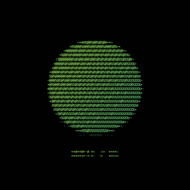

# Demostración local

Tres figuras generadas localmente (círculo lima, triángulo violeta y portal cian), convertidas a caracteres de color. GIF 320 × 320, cinco segundos por imagen, bucle infinito. No contiene fotografías externas ni datos personales.

Regenerar el GIF y la captura del editor con `npm run demo` después de instalar Chromium para Playwright. El test decodifica el archivo descargado y comprueba dimensiones, tiempos, bucle y contenido.
