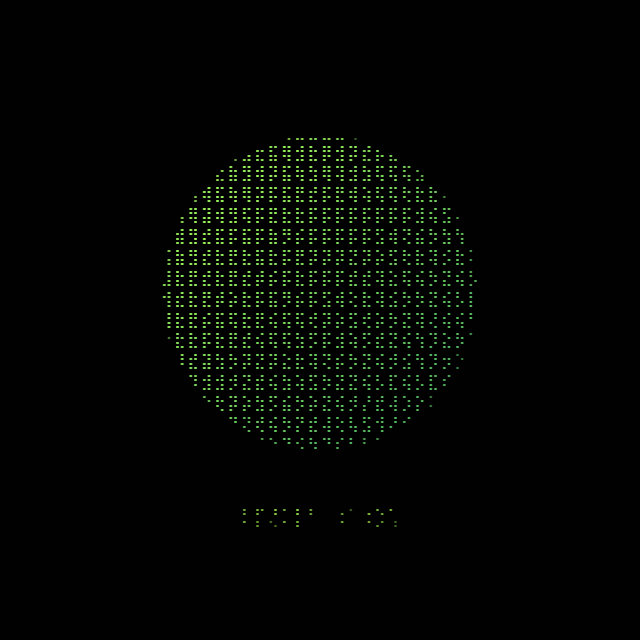

# V0.3 — Character Sets & True Braille

Implementación propia del selector y del motor, sin copiar componentes ni código de GitAscii. Se conservan el editor, las importaciones, orden, reproducción, intervalos, resolución, densidad, ajustes y el exportador GIF secuencial.

## Catálogo

`src/core/styles.ts` es la fuente de verdad. Las muestras se presentan de oscuro a claro (el espacio aparece como `␠` solo en la interfaz).

| ID estable | Nombre | Cantidad | Comportamiento |
| --- | --- | --- | --- |
| detailed | Detailed / Classic ASCII | 70 | Clásico detallado |
| standard | Standard | 10 | Paleta original |
| blocks | Simple | 7 | Paleta simple original; se conserva su ID histórico |
| shading | Blocks / Shading | 5 | Espacio y tramas `░▒▓█` |
| dots | Braille / Dots | 9 | Rampa convencional según cantidad de puntos |
| hex | Matrix / Hex | 8 | Espacio y hexadecimales `c7f1E08` |
| binary | Binary | 3 | Espacio, `1`, `0` |
| slash | Slash Pattern | 7 | Puntos, diagonales y cruces |
| orbs | Retro Orbs | 6 | Puntos, anillos y disco |
| minimal | Minimal | 4 | Espacio, punto, dos puntos, almohadilla |
| true-braille | True Braille 2×4 | 256 patrones | Ocho muestras independientes, no rampa |
| custom | Custom | 2–128 grafemas | Orden escrito por el usuario |

**Corrección de Classic:** V0.2 mostraba “70” aunque la cadena tenía 67 caracteres. Se añadieron apóstrofo, menor y mayor, conservando el resto y el ID. Standard y Simple permanecen iguales. Las rampas clásicas mantienen su orden perceptual histórico; su cobertura física puede variar con la fuente del sistema. Las nuevas rampas se verifican con la fuente empaquetada por cobertura de tinta creciente; `/` y `\` tienen cobertura equivalente. Custom respeta el orden escrito y nunca lo reordena por su cuenta.

## True Braille 2×4

Para cada carácter se muestrean dos columnas por cuatro filas en el área real de la imagen. El ancho de muestras es `2 × columnas`; la altura, `4 × filas`. Las filas se calculan con el aspecto de la fuente y de la imagen, igual que en el resto del renderizador. El rectángulo se contiene sin deformaciones en la resolución cuadrada común.

```text
Posiciones Unicode       Valor del bit
1 4                      1   8
2 5                      2  16
3 6                      4  32
7 8                     64 128
```

1. Componer alpha sobre negro y aplicar brillo/contraste a cada muestra RGB.
2. Calcular luminosidad perceptual `0.2126R + 0.7152G + 0.0722B`.
3. Activar si la luminosidad es mayor o igual al umbral (0–255, inicial 128). Alpha cero siempre permanece apagado, también con brillo alto, umbral cero o errores de dithering.
4. Opcionalmente distribuir el error Floyd–Steinberg hacia derecha / abajo-izquierda / abajo / abajo-derecha con pesos 7/16, 3/16, 5/16 y 1/16. Dos filas de error se conservan entre celdas y tiras, no se reinician en cada carácter.
5. Combinar los bits y producir `String.fromCodePoint(0x2800 + máscara)`. El vacío es U+2800 y el completo U+28FF; los 256 patrones son posibles.
6. Usar el promedio RGB ajustado de las muestras activas, o tinta lima en monocromo. Es una aproximación del color; no conserva energía luminosa exacta ni todos los matices.

**Importante:** todos los patrones se dibujan desde el mismo origen tipográfico del patrón completo. Centrar cada caja de tinta individual desplazaría un punto superior al centro y destruiría la geometría Braille. Hay una prueba raster que compara las posiciones superiores e inferiores, además de las pruebas puras de los ocho bits y todos los códigos.

El algoritmo está en `src/core/braille.ts`, separado del mapeo normal. `renderAscii` selecciona el algoritmo, pero tanto preview como GIF llaman a ese mismo renderizador. El encoder GIF no contiene lógica de estilos ni depende de tipografías.

## Custom y preferencias

- Se segmentan **grafemas** con `Intl.Segmenter`, no unidades UTF16 ni solo puntos de código. `é`, `e + acento` y secuencias ZWJ como `👩‍💻` no se fragmentan al convertir o invertir.
- Se normaliza NFC. Se rechazan duplicados tras normalización, controles, saltos de línea, sustitutos inválidos, espacios especiales, formatos invisibles aislados y paletas sin tinta visible. El espacio ASCII es válido y significativo, incluso al inicio o final.
- De 2 a 128 grafemas y hasta 2048 unidades UTF16. Usa un espacio como primer nivel si quieres que las zonas oscuras puedan quedar vacías.
- La muestra textual y el contador cambian inmediatamente. Canvas conserva el debounce de 160 ms. Un borrador inválido muestra el error, conserva la última preview válida y bloquea exportar; no se guarda el borrador inválido.
- Los emojis de fuentes de color se rasterizan a una máscara alfa de referencia, se tiñen con el color solicitado y se escalan: así respetan color original/monocromo incluso en tamaños donde esas fuentes no pueden rasterizar directamente.
- Se guardan exclusivamente `ramp`, `customRamp`, `brailleThreshold` y `brailleDither` en la clave `ascii-motion-carousel:characters:v1`. Nunca imágenes, archivos ni GIF. La lectura valida tipos y límites; si Storage está denegado o lleno se utiliza solo la sesión y se muestra aviso.

## Tipografía, dependencia y atribución

Se añade **`dejavu-fonts-ttf` 2.37.3**. Vite empaqueta localmente:

- `DejaVuSansMono.ttf` para los símbolos convencionales nuevos.
- `DejaVuSans.ttf` para Braille y como respaldo Unicode de Custom. **Sans Mono no cubre Braille** según `unicover.txt`; no se confía en ese nombre ni en una fuente del sistema para los 256 patrones.

La prueba `font-coverage.test.ts` inspecciona la tabla Unicode cmap de DejaVu Sans y comprueba 256 glifos Braille distintos presentes. Se espera a cargar las fuentes antes de medir/dibujar, evitando diferencias entre preview y exportación por fallback tardío. Los tres modos clásicos conservan monospace del sistema para evitar cambios innecesarios; Custom puede requerir respaldo del sistema para símbolos o emojis fuera de DejaVu.

Las fuentes se distribuyen sin modificar. Copyright Bitstream/Arev y cambios DejaVu de dominio público según la licencia del paquete. La licencia completa se incluye en **`dist/licenses/DejaVu-LICENSE.txt`**, accesible también desde el selector. Consulta [DejaVu Fonts](https://dejavu-fonts.github.io/) y el archivo `node_modules/dejavu-fonts-ttf/LICENSE`. No hay CDN, llamadas remotas de tipografía, componentes copiados de GitAscii ni nuevas cuentas o servicios.

## Cómo agregar un conjunto convencional

1. Añade una entrada a `CHARACTER_STYLES` en `src/core/styles.ts`, con ID estable, nombre, cadena de oscuro a claro, `kind: 'ramp'` y descripción.
2. Usa grafemas únicos y al menos dos niveles; el primer carácter suele ser espacio. Mide la cobertura de tinta con la fuente correspondiente para ordenar la paleta. No asumas que el orden alfabético/hexadecimal equivale al brillo.
3. Comprueba cobertura de los glifos en la fuente local. Los estilos nuevos utilizan las fuentes de símbolos por defecto; modifica `fontForStyle` solo si necesitas una familia distinta y cárgala antes de medir.
4. El tipo `StyleId`, selector, contador, parser de preferencias y mapeo se derivan del catálogo. No añadas otra conversión al exportador: preview y GIF deben seguir compartiendo `renderSource` / `renderAscii`.
5. Ejecuta los tests de catálogo y navegador. Los bucles parametrizados prueban automáticamente las entradas nuevas; actualiza las expectativas de cantidad de estilos y añade comprobaciones de cobertura de tinta si corresponde.

Un **algoritmo nuevo**, a diferencia de una paleta, necesita su módulo puro, el discriminante/tipo pertinente y una rama explícita en Canvas, siguiendo `braille.ts`. No lo disfraces como una rampa.

## Calidad, rendimiento y límites

- Se conservan caché de renders de 16 MiB, máximo 2048 filas, fuentes temporales de hasta 2048 px, GIF máximo 32 MiB y worker secuencial de dos RGBA.
- El cache de métricas tipográficas se limita a 16 entradas. El muestreo Braille puede ocupar hasta 18,75 MiB en un retrato extremo de 300 columnas / 2048 filas, frente a los 9,375 MiB del muestreo convencional. Las máscaras de emoji son temporales por render y se liberan al terminar/cancelar.
- A 300 columnas y baja resolución los puntos pueden ser ilegibles; el aviso de resolución sigue vigente. Dithering aumenta textura, no garantiza mejoras en todas las imágenes; prueba distintos umbrales.
- Se requiere `Intl.Segmenter`, Canvas, FontFaceSet y Web Workers de navegadores modernos. Chromium, Firefox y WebKit están automatizados; Safari/iOS, builds de marca y grafemas Custom arbitrarios requieren validación manual. Consulta la [matriz de compatibilidad](../compatibility.md). Un glifo fuera de las fuentes disponibles puede aparecer como sustitución; no existe cobertura Unicode universal.
- Los presupuestos de buffers y heap JS no son RAM total del navegador. Se mantienen las limitaciones de decodificación y paletas de V0.2.

## Pruebas y demo

```sh
npm test
npm run build
npm run test:e2e
```

Vitest cubre catálogo, orden de mapeo, grafemas, validación, preferencias, umbral/color/alpha, bits, 256 máscaras, dithering y archivo de fuente. Playwright comprueba los 12 estilos en preview/GIF, cobertura de tinta de las rampas nuevas, selector por teclado, Custom/inversión/monocromo/recarga, posiciones de puntos, alta densidad, transparencia y regresiones del editor/exportador.

Validación final con Node **22.23.5** y Chromium **158.0.8127.18**:

| Comprobación | Resultado |
| --- | --- |
| `npm test` | 96/96, nueve archivos |
| `npm run build` | TypeScript y Vite correctos; ambas fuentes y licencia incluidas |
| `npm run test:e2e` | 36/36 en desarrollo |
| E2E con `E2E_PREVIEW=1` | 36/36 contra `dist/` |
| `npm run demo` | 1/1; demo clásica actualizada |
| Regresión de 20 imágenes / 300 columnas / 2048 px | 14,45 s; GIF 2.837.347 bytes; dos buffers RGBA (32 MiB) en el worker; latido máximo observado 40,4 ms |

La regresión de 20 imágenes usa el estilo Standard y tres patrones sintéticos alternados de 1600×1200; no es un benchmark de todos los conjuntos. True Braille se exporta y compara a 300 columnas por separado, y todos los estilos se renderizan a esa densidad. La memoria RGBA contabilizada no es memoria total del navegador. Los fallos de desarrollo (paleta Hex no monotónica, hipótesis de posiciones sin considerar filas medidas y mínimo de rasterización de emoji) se corrigieron antes de esta ronda final.

La demo tiene tres figuras, cinco segundos cada una, 48 columnas, salida 640 × 640, umbral 128 y dithering:



- [PNG del Canvas interno](./preview.png)
- [Captura del editor](./editor.png)

Para regenerar los tres archivos en PowerShell con Node 22:

```powershell
$env:GENERATE_V03_DEMO='1'
npm run test:e2e -- tests/characters.spec.ts -g 'True Braille 2×4:'
Remove-Item Env:GENERATE_V03_DEMO
```

Las pruebas normales no sobrescriben estas demos. No se ha publicado ningún GIF ni se ha hecho push/merge.
