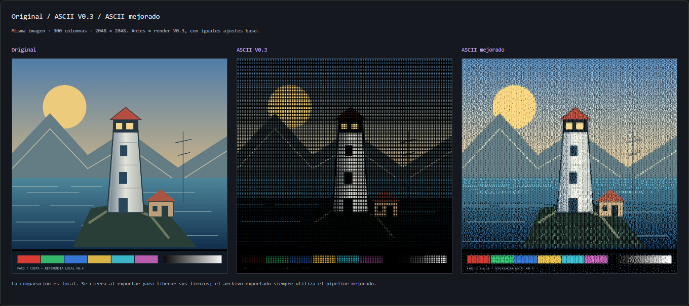

# V0.4 — procesamiento y fidelidad

## Diagnóstico previo y alcance de la referencia

El [diagnóstico previo](./DIAGNOSIS.md) fija el commit de GitAscii inspeccionado, compara diez aspectos del pipeline y evalúa su licencia GPL. **No se ha copiado su código.** Los algoritmos estándar se implementaron de forma independiente; los controles no usan escalas supuestamente equivalentes.

La oscuridad local tenía dos causas principales: densidad baja **multiplicada por tinta RGB oscura**, y margen tipográfico que impedía que incluso `█` llenara su celda. GIF no era la causa: la imagen ya estaba oscura en Canvas.

## Evidencia visual antes/después

Referencia fija propia: un faro y una costa con gradientes, ventanas, mástil, trazos finos y seis muestras RGB. No contiene fotos de terceros ni datos personales. Fuente: `tests/fixtures/reference-v04.svg`; PNG exacto: `public/reference-v04.png`.



| Archivo | Descripción |
| --- | --- |
| [Original](./original.png) | Imagen de entrada, 1024 px |
| [Antes V0.3](./before-v03.png) | Capturado **antes** de implementar; Shading, 300 columnas, 2048 px |
| [Después V0.4](./after-v04.png) | Misma imagen, columnas, resolución, tamaño y ajustes base; dithering activo |
| [Detalle al 100%](./detail-100.png) | Recorte de píxeles nativos, sin agrandar ni superponer foto |
| [GIF](./after-v04.gif) | Exportación de un frame de referencia, decodificada por el test; la demo general mantiene tres frames animados |
| [Muestra ASCII literal](./ascii-sample.txt) | Fila central generada con caracteres Unicode reales |
| [Métricas](./metrics.json) | Datos observados, parámetros, SHA256 de la entrada y versión del navegador |

Las condiciones base son Shading / 300 columnas / 152 filas / 2048 × 2048, contraste 1,15, brillo 0, tamaño 1. V0.4 utiliza gamma1, niveles/bordes/inversión apagados y dithering de densidad activo (nuevo valor inicial). La comparación integrada reconstruye V0.3; en Chromium el test confirma que sus píxeles coinciden con la captura histórica (MAE prácticamente cero). Firefox y WebKit usan una tolerancia acotada por su distinto antialiasing; consulta la [matriz de compatibilidad](../compatibility.md).

### Resultados en la referencia fija

| Medida (0–255 salvo indicación) | Original / objetivo | V0.3 | V0.4 |
| --- | --- | --- | --- |
| Luma media de todo el raster | 113,69 | 29,87 | 110,67 |
| MAE RGB de seis regiones de color | 0 | 96,77 | 3,65 |
| MAE de gradientes en ROI del faro/costa | 0 | 2,018 | 1,562 |

El error de las regiones de color baja aproximadamente **96,2%**; el de gradientes, **22,6%**. El análisis de contornos reduce original/resultado a la misma cuadrícula y aplica el mismo promedio3×3 **solo para medir**, no para dibujar ni exportar. Evita confundir la textura de los glifos con el contorno de la escena. Las coordenadas y fórmulas están en `tests/fidelity.spec.ts`.

Los cinco controles también tienen [diferencias medibles en los píxeles](./filter-effects.json), además de cambiar la selección de caracteres: se prueban uno por uno y se exige restaurar el PNG exacto al apagarlos. No se da por bueno un cambio solo de interfaz o metadatos.

Esto demuestra una mejora sobre **nuestro V0.3 en esta ilustración**, no superioridad universal, OCR ni paridad empírica con la aplicación GitAscii. No se ejecutó un benchmark remoto equivalente ni se le enviaron imágenes. Los resultados con fotografías arbitrarias, fuentes distintas y paletas poco densas pueden variar.

### Comprobaciones finales

Node22.23.5, Chromium158.0.8127.18, Windows. Esta sección conserva la ejecución original en Chromium; la validación multi-motor posterior está en la [matriz de compatibilidad](../compatibility.md):

| Comprobación ejecutada | Resultado observado |
| --- | --- |
| `npm test` | 110/110 en diez archivos |
| `npm run build` | TypeScript estricto y Vite correctos |
| `npm run test:e2e` | 40 correctos en desarrollo; 1 captura histórica omitida deliberadamente |
| E2E con `E2E_PREVIEW=1` | 40 correctos contra el build; la misma omisión histórica |
| `npm run demo` | 1/1, carrusel animado de tres imágenes |
| GIF frente a preview | Error medio por canal3,194/255 en5000 píxeles deterministas, por cuantización de paleta |
| Comparación V0.3 reconstruida frente a captura previa | MAE0: no se simula el “antes” oscureciendo el resultado nuevo |
| 20 imágenes Standard / 300 columnas / 2048 px | 15,988s; GIF8.618.532B; pico de dos RGBA del worker32MiB; mayor separación del latido54,7ms |

El [informe de rendimiento](./performance.json) registra esa ejecución de producción con20 archivos1600×1200 y tres patrones alternados. No mide RAM total ni equivale a un benchmark de20 fotografías arbitrarias. Otras ejecuciones tardaron~16s; la concurrencia/equipo afectan los números.

La validación de producción encontró una carrera durante el debounce: el booleano de “listo” podía corresponder al render anterior. Se corrigió enlazando **clave solicitada/completada de imagen, ajustes y resolución**; la vista y la comparación no se declaran listas hasta copiar los píxeles de esa configuración. Un test con reloj congelado comprueba159/160ms y descarta estados obsoletos.

## Pipeline compartido

```text
File local → bitmap temporal → cuadrícula por aspecto/fuente
→ promedio2×2 por celda (Braille conserva2×4)
→ RGB compuesto sobre negro + luma perceptual
→ contraste/brillo sobre intensidad → gamma
→ niveles por percentiles → Sobel guiando contraste local
→ densidad + inversión → cuantización/dithering
→ máscaras de glifos reales + color → Canvas
→ preview o los mismos RGBA al worker GIF
```

La única rama histórica es V0.3, explícitamente etiquetada en la comparación. No se usa como preset ni se mezcla con el GIF mejorado.

### Muestreo, luma, niveles y gamma

- Se conserva la imagen completa y su proporción: no se replica el recorte cuadrado de la referencia. La fuente se decodifica temporalmente hasta 2048 px y se muestrea a partir de regiones, no de una rejilla fotográfica dibujada encima.
- RGB se compone sobre negro **una sola vez**; alpha cero se excluye del histograma, de los bordes y del mapeo, incluso al invertir. Semitransparencias no se multiplican de nuevo al entrar en True Braille.
- Se usa luma perceptual de sRGB codificado: `Y′ = 0.2126R + 0.7152G + 0.0722B`. No se llama a esto luminancia radiométrica lineal ni se equipara a la linealización de GitAscii.
- Contraste multiplicativo alrededor128 y brillo±80 actúan sobre Y′, preservando cromaticidad. Gamma perceptual es `255 × (Y′/255)^(1/gamma)`, rango0,5–2,5; gamma>1 levanta medios tonos. No traslades ciegamente valores de GitAscii.
- Auto Contrast analiza un histograma de256 bins ponderado por alpha. Percentiles configurables: inferior0–10%, superior90–100%, inicial1/99. Se centra el intervalo y limita la ganancia a4×; si el intervalo tiene menos de16 niveles se omite el estiramiento para no amplificar ruido de una imagen casi plana. Hay recorte controlado de las colas; revisa luces/sombras y apaga el control si no conviene.

### Edge Enhancement

Sobel3×3 calcula derivadas horizontal/vertical. Un umbral de8 niveles descarta variaciones pequeñas. La magnitud guía una **corrección con signo de contraste local** (diferencia del centro respecto a sus cuatro vecinos): oscurece el lado oscuro y aclara el claro, en vez de blanquear ambos lados. El aporte absoluto se limita a64 niveles multiplicados por la intensidad0–2 y se atenúa con detalle local débil. Los planos y gradientes lineales interiores no se realzan; las transparencias vecinas no generan halos artificiales. Intensidades altas todavía pueden introducir halos o recortes: no es una recuperación mágica de detalle inexistente.

### Cobertura, tinta y glifos

`glyph-atlas.ts` rasteriza **texto real a 100 px**, mide avance, línea, bbox y suma de alpha, y valida los límites antes de recortar. No contiene máscaras de fotos. Shading usa el patrón completo como celda de referencia y elimina el margen0,76; `█` alcanza aproximadamente0,981 de cobertura medida. Se conserva el orden `espacio → ░ → ▒ → ▓ → █` y se calibran sus niveles reales.

Para los conjuntos convencionales se elige la cobertura más cercana, calibrada respecto a la tinta máxima de la paleta. **Custom mantiene el orden ordinal escrito por el usuario**; no se reordena su Unicode. Para conservar color se separan cromaticidad y densidad: la tinta se normaliza con `RGB / max(R,G,B)` y la intensidad va en la cobertura, evitando aplicar oscuridad dos veces. En Shading, la media de las celdas aproxima así el RGB regional; las paletas dispersas no pueden alcanzar el brillo físico de una foto: carecen de un glifo que llene toda la celda.

Las máscaras alfa se reducen con alta calidad a tamaños nativos y se almacenan por glifo/ancho/alto de celda. Se aplican a un ImageData opaco con cesión del hilo cada~8ms, en vez de cientos de miles de operaciones Canvas de composición. Esto conserva glifos reales y mejora rendimiento. Las celdas comparten límites redondeados para evitar costuras entre bloques completos. El tamaño de carácter se limita al interior de su celda; valores>1× no desbordan ni recortan (el panel informa de ese límite).

### Dithering e inversión

Floyd–Steinberg difunde el error de **densidad** hacia derecha/abajo, antes de elegir caracteres. No se aplica error a RGB ni se altera el matiz regional. Es reversible y está activo inicialmente para evitar bandas visibles en rampas cortas. Apagarlo conserva el nuevo render pero puede aumentar bandas y error de gradientes.

Invert Character Density cambia `densidad → 1−densidad`, no invierte el RGB ni activa píxeles transparentes. Inicia el render sin esperar el debounce del slider. Los demás cambios rápidos conservan160ms de debounce. True Braille mantiene sus ocho bits, umbral y color promedio de puntos activos; usa la intensidad procesada y su control específico Floyd–Steinberg, conservando la semántica de V0.3. El dithering general se deshabilita visualmente en ese modo y recuerda su valor para las rampas: nunca se aplica doble difusión.

## Calidad no equivale a resolución

- Las columnas y métricas de fuente definen el contenido. Gamma, histograma, bordes y selección de glifos operan en esa cuadrícula, **sin depender del tamaño del GIF**.
- 320 / 640 / 1024 / Auto cambian el raster final. El test comprueba el mismo hash de glifos/colores en todas esas resoluciones para la misma entrada y parámetros.
- **Ajustar / 100% / 200%** solo afectan CSS. 100% corresponde a un píxel CSS por píxel del Canvas; 200% usa vecinos de píxeles para inspección. Las pruebas verifican dimensiones reales y que PNG/hash no cambian con zoom.
- Ajustar300 columnas en380 px implica aproximadamente1,27 px por celda: ningún escalado puede conservar la legibilidad individual de todos los caracteres. El aviso invita a100%. No se reduce secretamente la densidad ni se exporta la versión reducida.
- No se recuperan trazos menores que el muestreo ni se promete que toda paleta sea legible a320 px/300 columnas.

## Comparación y presets

Activa **Comparar antes/después**: original, render V0.3 reconstruido y render mejorado, con igual imagen, paleta, columnas, resolución y ajustes base. Se recalculan al cambiar controles. Se cierra al exportar para liberar sus tres lienzos; volver a abrir no cambia la imagen ni ajustes. **Cargar referencia local** permite reproducir esta prueba sin descargar imágenes remotas.

Los presets son parches de los mismos controles, nunca otro algoritmo, y no cambian columnas ni resolución:

| Preset | Estilo y ajustes principales |
| --- | --- |
| [Classic ASCII](./preset-classic.png) | Detailed, gamma1,15, sin niveles/bordes/dither |
| [High Detail](./preset-detail.png) | Detailed, gamma1,3, niveles1/99, Sobel0,2, dither |
| [Edge Enhanced](./preset-edge.png) | Standard, gamma1,15, niveles, Sobel0,85, dither |
| [Color Fidelity](./preset-color.png) | Shading, contraste1, gamma1, sin niveles/bordes, dither |
| [Retro Terminal](./preset-retro.png) | Hex monocromo, contraste1,35, gamma1,25, niveles, Sobel0,15 |

**Desactivar procesamiento** apaga los filtros nuevos, pone gamma1 y mantiene los controles base de brillo/contraste/color/densidad. No restaura el renderer oscuro V0.3. **Restablecer** recupera los valores iniciales V0.4, incluido dithering activo, zoom ajustado y comparación cerrada. Los filtros/presets/zoom no se guardan en preferencias locales: se conserva el alcance de persistencia de caracteres de V0.3.

## Memoria, exportación y límites

- Continúan:20 archivos,10MiB/16MP por fuente, render-cache16MiB de RGBA, worker con pendiente+entrante32MiB a2048, GIF≤32MiB, timeout120s por respuesta.
- Atlas de glifos: caché16MiB; cada atlas se valida antes de reservar lienzos (lados≤512 px de referencia y conjunto≤16MiB). Grafemas exóticos con cajas enormes se rechazan con error para evitar asignaciones excesivas.
- Se añade ImageData de trabajo de hasta16MiB y buffers de intensidad solo del frame actual. Muestreo/histograma/Sobel ceden el hilo por bloques; no se guardan veinte planos de procesamiento.
- Abrir la comparación añade hasta48MiB de backing stores a2048, además del Canvas principal. Se libera al cerrar/exportar. Decodificar una fuente puede tener picos transitorios.
- Dithering y mayor cobertura aumentan entropía y peso GIF. La regresión de20 imágenes Standard/300/2048 pasó de~2,84MB en V0.3 a~8,62MB en la ejecución V0.4 de desarrollo; sigue dentro del límite. Reduce resolución, imágenes o dithering si el archivo resulta pesado.
- Estas cifras son presupuestos de buffers, no RAM total del navegador. La cuantización GIF puede perder matices y añadir error; el archivo decodificado se compara con el Canvas, no solo con el aspecto del elemento HTML.
- Chromium, Firefox y WebKit automatizados; WebKit no equivale a Safari y Safari/iOS, fotografías arbitrarias y todas las fuentes de respaldo siguen pendientes de validación manual. No se envían imágenes a servidores ni se hace publicación GitHub.

## Reproducción

Con Node22:

```sh
npm test
npm run build
npm run test:e2e
npm run demo
```

Para regenerar resultados V0.4 (no la captura V0.3) en PowerShell:

```powershell
$env:GENERATE_V04_ARTIFACTS='1'
npm run test:e2e -- tests/fidelity.spec.ts
Remove-Item Env:GENERATE_V04_ARTIFACTS
```

`fidelity-baseline.spec.ts` está omitido intencionadamente en la suite normal: la captura se hizo antes de implementar. Su modo explícito exige encabezado V0.3 para impedir sobrescribir el historial con el motor nuevo. Los otros tests comprueban el archivo histórico, la imagen fija, reversibilidad real, cambios de hash, igualdad de contenido entre resoluciones, zoom sin modificaciones de píxeles, las doce paletas procesadas y GIF decodificado.
